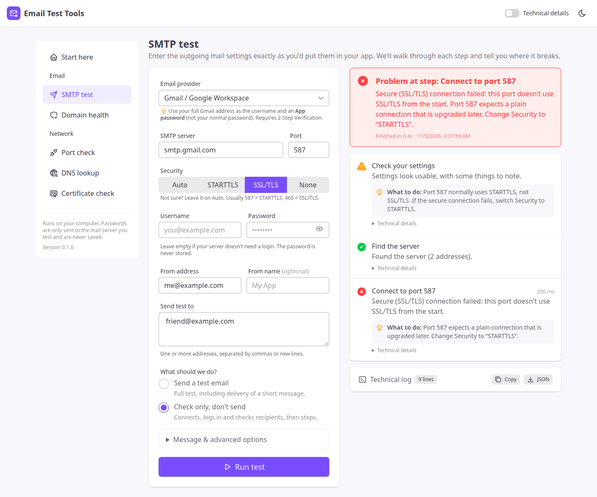
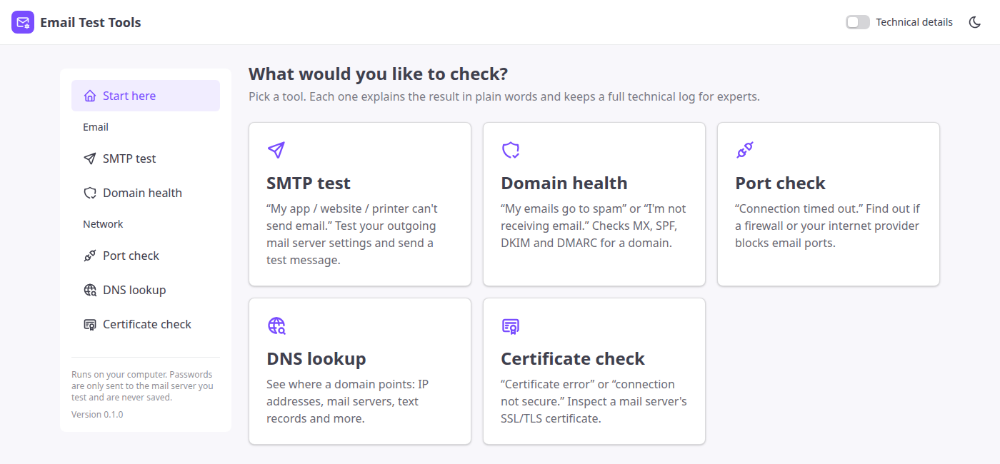
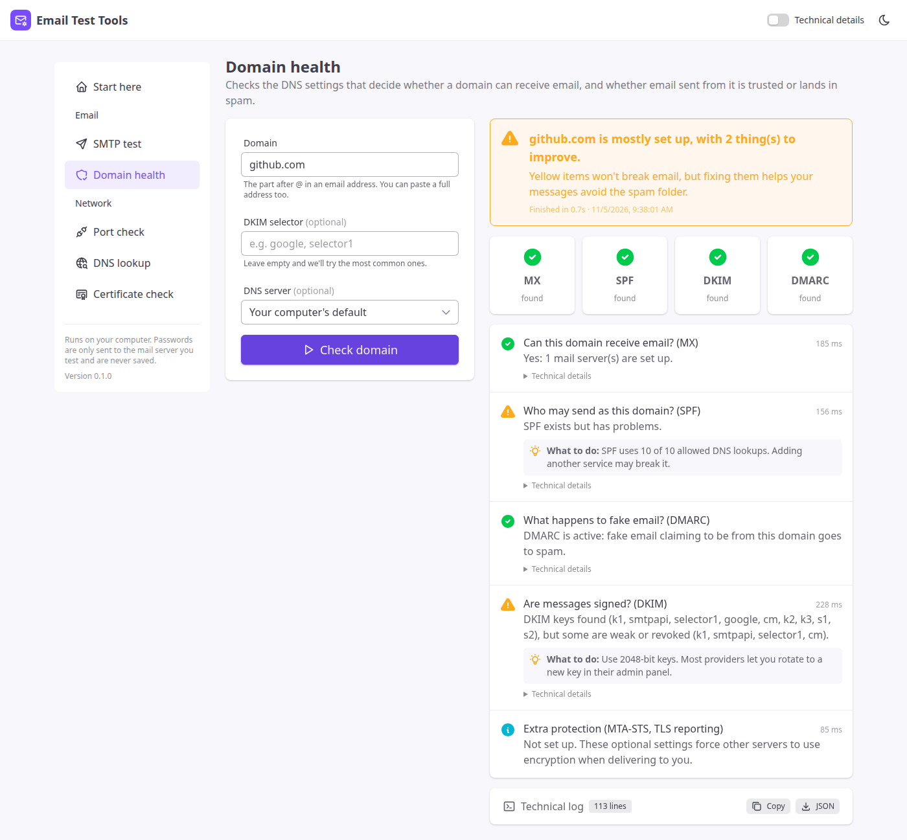
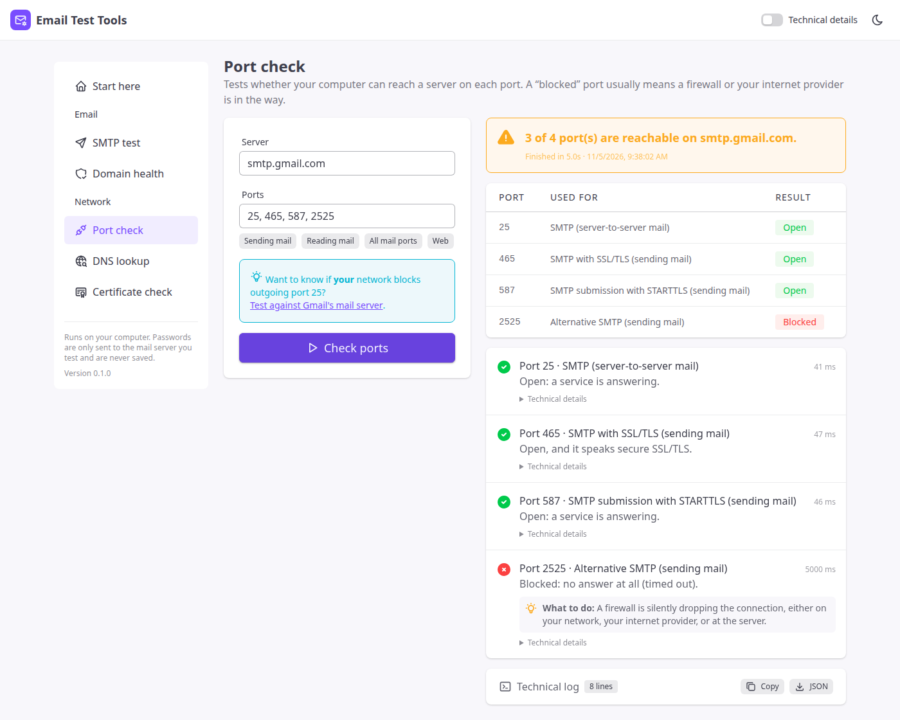
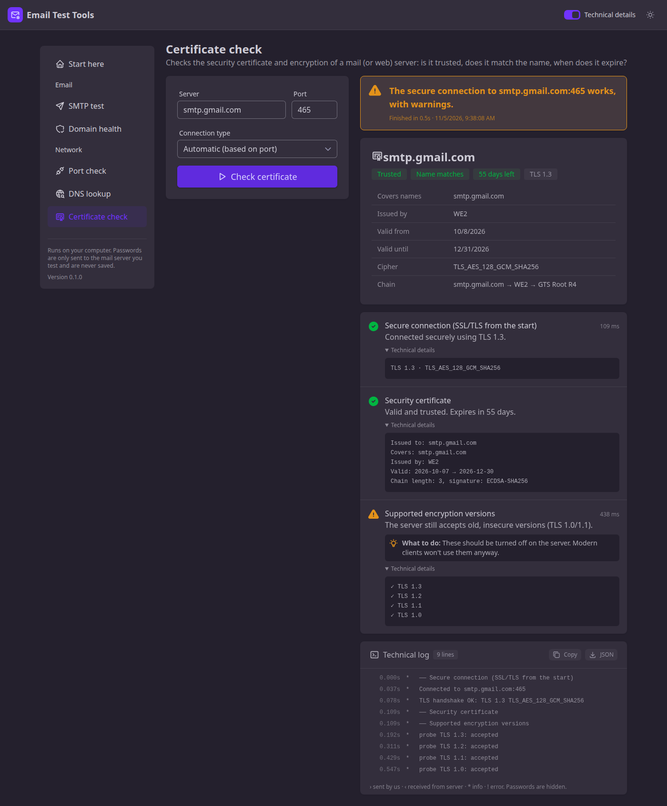
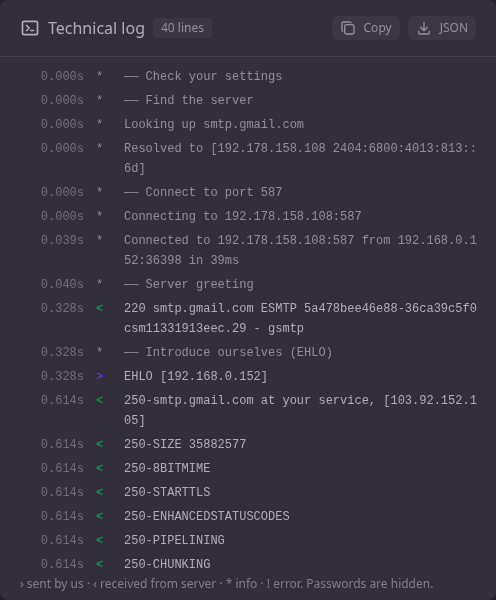

<div align="center">


# Email Test Tools

**Find out why email isn't working, in plain language.**

Test SMTP settings, check a domain's SPF/DKIM/DMARC, see if a firewall blocks mail ports, and inspect certificates.
Every result explains itself, with a full protocol log for the experts.

[](https://github.com/nahidacm/email-test-tools/actions/workflows/ci.yml)
[](https://github.com/nahidacm/email-test-tools/releases/latest)
[](LICENSE)

[**Download**](https://github.com/nahidacm/email-test-tools/releases/latest) · [User guide](docs/user-guide.md) · [Development](docs/development.md)



</div>

## Why?

“SMTP error: could not connect” tells you nothing. Email Test Tools walks through each stage of the conversation with a mail server and tells you **exactly which step failed, what it means and what to do**. For example, “Port 587 expects a plain connection that is upgraded later. Change Security to STARTTLS”, or “Gmail doesn't accept your normal password here; create an App password”.

It runs **on your own computer** (nothing to sign up for, no data sent to us) and installs as a **single small program**.

## Tools

| | Tool | Use it when… |
|---|---|---|
| ✉️ | **SMTP test** | Your app, website, printer or CMS can't send email. Tests connect → encrypt → log in → sender → recipients → send, with presets for Gmail, Microsoft 365, Yahoo, Zoho, iCloud, Amazon SES, SendGrid, Mailgun and MailHog/Mailpit. Has a *check only, don't send* mode. |
| 🛡️ | **Domain health** | Your email lands in spam, or a domain doesn't receive mail. Checks MX, SPF (including the 10-lookup limit), DKIM, DMARC, MTA-STS and TLS-RPT. |
| 🔌 | **Port check** | You see “connection timed out”. Shows whether ports 25/465/587/993… are open, closed or silently blocked by a firewall or your ISP. |
| 🌐 | **DNS lookup** | You want to see A, AAAA, MX, TXT, NS, CNAME or PTR records, optionally through a specific DNS server. |
| 🔒 | **Certificate check** | You get “certificate error” or “connection not secure”. Checks trust, name match, expiry and TLS versions (SSL/TLS or STARTTLS). |

## Screenshots

| Start page | Domain health |
|---|---|
|  |  |
| **Port check** | **Certificate check (dark theme, technical details on)** |
|  |  |

<details>
<summary><b>Technical log</b>: the full SMTP conversation, passwords hidden</summary>
<br>

</details>

## Install

### Windows
Download **`email-test-tools_<version>_windows_setup.exe`** from the [latest release](https://github.com/nahidacm/email-test-tools/releases/latest) and run it. No admin rights are needed. It adds Start-menu and desktop shortcuts and can be uninstalled from *Settings → Apps*.

Or with PowerShell:
```powershell
irm https://raw.githubusercontent.com/nahidacm/email-test-tools/main/scripts/install.ps1 | iex
```

> Windows SmartScreen may warn that the app is from an unknown publisher (it isn't code-signed yet). Click **More info → Run anyway**.

### macOS and Linux
```bash
curl -fsSL https://raw.githubusercontent.com/nahidacm/email-test-tools/main/scripts/install.sh | sh
```
The script picks the right build for your system, verifies its checksum, and installs to `/usr/local/bin` (or `~/.local/bin`).

### Debian / Ubuntu, Fedora / RHEL, Alpine
Download the package for your CPU from the [latest release](https://github.com/nahidacm/email-test-tools/releases/latest):
```bash
sudo apt install ./email-test-tools_*_linux_x86_64.deb     # Debian, Ubuntu, Mint
sudo dnf install ./email-test-tools_*_linux_x86_64.rpm     # Fedora, RHEL, Rocky
sudo apk add --allow-untrusted ./email-test-tools_*.apk    # Alpine
```
The packages also add an **Email Test Tools** entry to your desktop's application menu.

### Docker
```bash
docker build -t email-test-tools https://github.com/nahidacm/email-test-tools.git
docker run --rm -p 127.0.0.1:8587:8587 email-test-tools
```

### Manual
Every release also has plain `.tar.gz` / `.zip` archives for Linux, macOS and Windows (x86_64 and arm64). Unpack and run `email-test-tools`.

## Usage

```bash
email-test-tools
```
Your browser opens at **http://127.0.0.1:8587**. Close the window or press **Ctrl+C** to stop.

| Option | Default | Description |
|---|---|---|
| `--addr` | `127.0.0.1:8587` | Address to listen on. A free port is chosen if 8587 is busy. |
| `--no-browser` | off | Don't open the browser automatically. |
| `--version` | | Print the version and exit. |

See the **[User guide](docs/user-guide.md)** for a walkthrough of each tool and fixes for the most common email problems.

## Privacy & security

- **Local only.** The app listens on `127.0.0.1`, so other computers on your network can't use it.
- **Passwords** go only to the SMTP server you're testing. They are never stored or written to logs. Other form fields are remembered in your browser for convenience.
- **Protected API.** Requests from other websites and DNS-rebinding attempts are rejected, so a web page can't use the app to probe your network.
- Running with `--addr 0.0.0.0:8587` exposes the tools to your network. Anyone who can reach it can make your machine connect to any host. Only do this on a trusted network.

## Built with

[Go](https://go.dev) (standard library only) · [Tailwind CSS v4](https://tailwindcss.com) · [FlyonUI](https://flyonui.com) · [Tabler Icons](https://tabler.io/icons) · [GoReleaser](https://goreleaser.com) · [NSIS](https://nsis.sourceforge.io)

The UI is embedded in the binary, so there is nothing else to install. See **[docs/development.md](docs/development.md)** to build from source, add a tool, or cut a release.

## Contributing

Issues and pull requests are welcome. Ideas on the roadmap:
- Blacklist (DNSBL) check for sending IPs
- IMAP / POP3 login test
- Email header analyzer (paste headers → hops, delays, SPF/DKIM/DMARC verdicts)
- Built-in catch-all SMTP server for testing apps locally
- Live log streaming during long tests

## License

[MIT](LICENSE)
