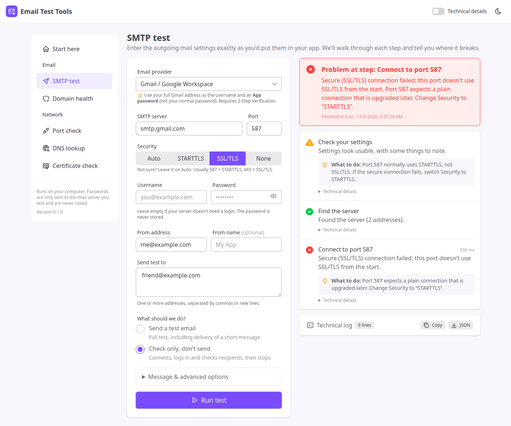
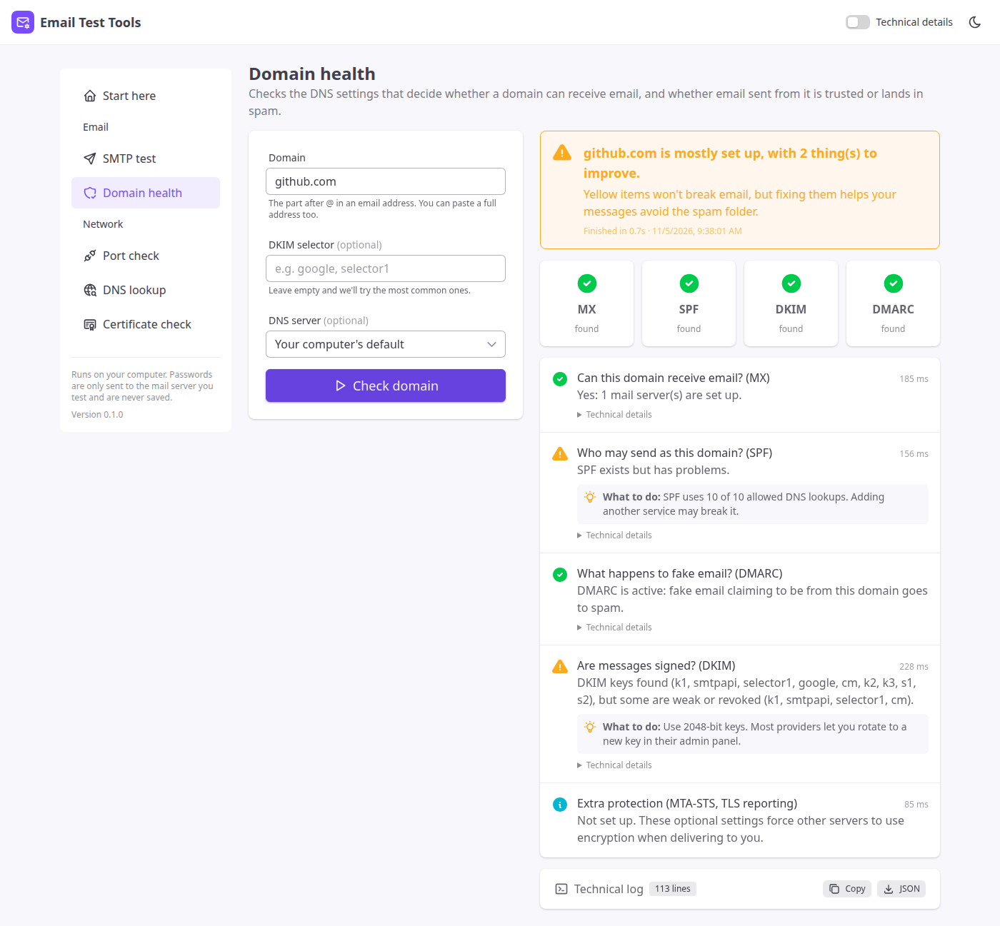
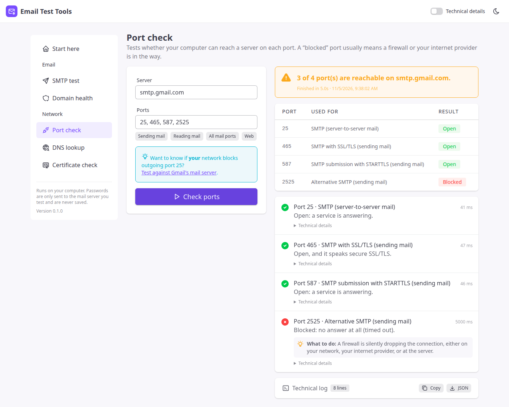
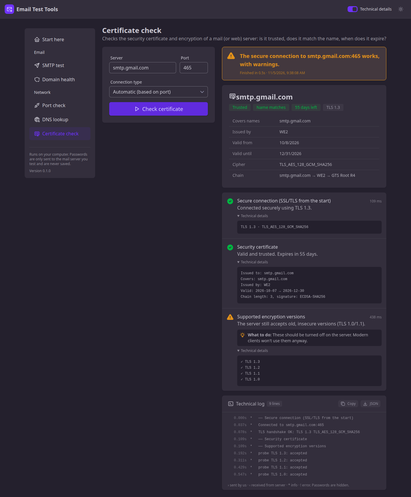

# User guide

This guide explains each tool, how to read the results, and how to fix the most common email problems. No technical background is needed.

- [Getting started](#getting-started)
- [Reading results](#reading-results)
- [SMTP test](#smtp-test)
- [Domain health](#domain-health)
- [Port check](#port-check)
- [DNS lookup](#dns-lookup)
- [Certificate check](#certificate-check)
- [Common problems & fixes](#common-problems--fixes)
- [Glossary](#glossary)

## Getting started

1. [Install](../README.md#install) the app and start it (Start menu on Windows, or run `email-test-tools` in a terminal).
2. Your browser opens at <http://127.0.0.1:8587>. If it doesn't, open that address yourself. The terminal window shows the exact address.
3. Pick a tool from the left menu.
4. To stop the app, close the terminal window or press **Ctrl+C** in it.

Everything runs on your computer. The only outside connections are the ones a test makes: to the mail server, DNS server or host you enter.

## Reading results

Each result has three layers:

1. **The headline box** gives the overall answer and the single most important thing to do.
2. **The steps** each show a status icon:
   - ✅ **Passed**: this part works.
   - ⚠️ **Warning**: it works, but something could be better or might cause problems later.
   - ❌ **Problem**: this is what's broken. Read **What to do** underneath.
   - ℹ️ **Info** / ⏭ **Skipped**: for your information, or not run (for example, sending is skipped in “check only” mode).
3. **Technical details & log** (click to expand) show raw server replies, error codes and timings. Turn on **Technical details** in the top bar to have these open by default.

When asking for help (from your hosting company, IT team or a forum), click **Copy** on the technical log, or **JSON** to download the full result, and share that. Passwords are always replaced with `[credentials hidden]`.

## SMTP test

Use this when an app, website, printer, scanner or CMS can't send email.

1. **Email provider**: choosing one fills in the server, port and security for you, and shows a tip specific to that provider.
2. **SMTP server / Port**: as given by your provider. The usual combinations:

   | Port | Security | Notes |
   |---|---|---|
   | 587 | STARTTLS | The standard for sending from apps. Use this first. |
   | 465 | SSL/TLS | Also common, and encrypted from the start. |
   | 25 | STARTTLS / none | Server-to-server. Usually blocked on home and cloud networks. |
   | 2525 | STARTTLS | Alternative offered by some services (SendGrid, Mailgun…). |

3. **Security**: leave it on **Auto** if unsure. Auto uses SSL/TLS on port 465 and STARTTLS everywhere else (when the server offers it). If encryption isn't available, Auto refuses to send your password unencrypted. Choose **None** only if you really mean to.
4. **Username / Password**: usually your full email address and password, or an *app password* (see below). Leave them empty for servers that don't need a login, such as an internal relay.
5. **From / Send test to**: the sender, and one or more recipients.
6. **What should we do?**
   - **Send a test email** runs the full test and delivers a short message.
   - **Check only, don't send** connects, logs in and checks that recipients are accepted, then stops before sending anything.
7. **Message & advanced options**: custom subject/body, the name we introduce ourselves with (HELO), the timeout, and *Don't verify the server certificate* for servers with self-signed certificates.

### What the steps mean

| Step | In plain words |
|---|---|
| Find the server | Look up the server's address on the internet (DNS). |
| Connect to port … | Knock on the door. Fails if the name is wrong, the port is closed, or a firewall is in the way. |
| Server greeting | The server says hello, which confirms it's really a mail server. |
| Introduce ourselves (EHLO) | We say hello back, and the server lists what it can do. |
| Encrypt the connection | Switch to an encrypted connection so nobody can read your password. |
| Log in | Send username and password. |
| Sender address | Tell the server who the email is from. |
| Recipients | Tell the server who it's for. Each address is accepted or rejected individually. |
| Send the message | Hand over the message. If accepted, the server takes responsibility for delivering it. |

> **“Accepted” doesn't always mean “delivered”.** The server has taken the message, but the recipient's provider can still put it in spam or drop it. If a test message doesn't arrive, check the spam folder, then run **Domain health** on the sender's domain.

## Domain health

Use this when emails from your domain land in spam, are rejected, or when you don't receive email at all. Enter a domain (`example.com`) or a full email address.

| Check | Question it answers | If it's missing |
|---|---|---|
| **MX** | Which servers receive email for this domain? | Nobody can email you. Add the MX records your email host gives you. |
| **SPF** | Which servers may send email as this domain? | Your mail is more likely to be marked as spam. |
| **DKIM** | Are messages digitally signed, proving they weren't altered? | Lower trust. Turn on DKIM in your email provider's admin panel. |
| **DMARC** | What should receivers do with email that fails SPF/DKIM? | Anyone can impersonate your domain. Gmail, Yahoo and Outlook now expect DMARC from bulk senders. |
| **MTA-STS / TLS-RPT** | Must other servers use encryption when sending to you? | Optional extra protection. |

**SPF tips**
- A domain must have **exactly one** SPF record. Two records break both.
- SPF may trigger **at most 10 DNS lookups**. Each `include:` counts, including the ones nested inside it. The tool counts these for you.
- End with `~all` (soft fail) or `-all` (strict). Never use `+all`, which allows anyone to send as you.

**DKIM tip:** DKIM keys live under a name called a *selector*. The tool tries about 35 common ones. If yours isn't found, open an email sent from the domain, view its original source/headers, find `DKIM-Signature: … s=XXXX;` and enter `XXXX` as the selector.

**DMARC rollout:** start with `p=none` and a `rua=` address to receive reports. Once the reports show all your real email passing, move to `p=quarantine`, then `p=reject`.

DNS changes can take from a few minutes up to 48 hours to appear everywhere. Choose a different **DNS server** in the form to compare.

## Port check

Shows whether your computer can reach a server on specific ports.

| Result | Meaning |
|---|---|
| **Open** | Something answers on this port. |
| **Closed** | The server is reachable, but nothing listens on this port. The port number is probably wrong, or the service is off. |
| **Blocked** | No answer at all. A firewall (yours, your ISP's, your cloud provider's, or the server's) is silently dropping the connection. |

**Is my network blocking port 25?** Click *Test against Gmail's mail server*. Gmail always listens on port 25, so if it shows as blocked, the block is on your side. That's normal for home internet and most cloud providers (AWS, Google Cloud, Azure, DigitalOcean…). Send through port 587 or 465 instead.

Tip: if a port is blocked at the office but works on a phone hotspot, the office firewall is the cause.

## DNS lookup

Looks up the records a domain publishes. Enter an IP address instead to find its name (reverse lookup / PTR).

| Type | Contains |
|---|---|
| A / AAAA | IPv4 / IPv6 addresses |
| MX | Mail servers (lower number = preferred) |
| TXT | Text records: SPF, verification codes, … |
| NS | The name servers in charge of the domain |
| CNAME | An alias pointing to another name |
| PTR | The name behind an IP address. Mail servers should have one that matches. |

## Certificate check

Checks the encryption and certificate of a mail (or web) server.

- **Connection type: Automatic** picks SSL/TLS for 465/993/995/443 and STARTTLS for 25/587/143/110.
- **Trusted**: issued by a public authority, with a complete chain.
- **Name matches**: valid for the exact server name you typed. A mismatch is the #1 cause of “certificate error” in mail apps, and usually means you should use the hosting provider's server name (e.g. `server123.hosting.com`) instead of `mail.yourdomain.com`.
- **Days left**: warns when fewer than 14 days remain.
- **Supported versions**: TLS 1.0/1.1 are outdated and should be disabled on the server.

## Common problems & fixes

| You see | Likely cause | Fix |
|---|---|---|
| *Username or password was rejected* (535) | Wrong credentials, or the provider requires an app password | Gmail, Yahoo, iCloud, Zoho with 2FA: create an **app password**. Microsoft 365: an admin must enable **Authenticated SMTP** for the mailbox. SendGrid: the username is literally `apikey`. Amazon SES: use **SES SMTP credentials**, not AWS keys. |
| *No response: the connection timed out* | Port blocked by a firewall or ISP | Try 587 or 465 instead of 25. Use **Port check** to compare ports. |
| *This port doesn't use SSL/TLS from the start* | SSL/TLS selected on port 587/25 | Set Security to **STARTTLS**. |
| *The server stayed silent* on port 465 | STARTTLS/None selected on 465 | Set Security to **SSL/TLS**. |
| *Certificate is for a different name* | Server name doesn't match the certificate | Use a name listed under “Covers names”. |
| *Relaying denied* (550 5.7.1) | Not logged in, so the server only accepts mail for its own domains | Enter username and password. |
| *Won't let you send as this address* (553/550) | From address doesn't belong to the account | Use your own address or a verified alias/domain. |
| *Recipient isn't allowed yet / not verified* | Amazon SES or Mailgun sandbox | Verify the recipient, or request production access. |
| Test accepted but the email never arrives | Spam filtering at the receiver | Run **Domain health** and fix SPF, DKIM and DMARC. Check the spam folder. |

## Glossary

- **SMTP**: the protocol used to *send* email.
- **IMAP / POP3**: protocols used to *read* email.
- **Port**: a numbered “door” on a server. Each service listens on its own number.
- **STARTTLS**: start with a plain connection, then switch to encryption.
- **SSL/TLS (implicit TLS)**: encrypted from the first byte.
- **Certificate**: a digital ID card that proves a server is who it claims to be.
- **DNS**: the internet's address book, which turns names into addresses and stores records like MX and SPF.
- **App password**: a separate password generated for one app, used instead of your main password when two-factor authentication is on.
- **Relay**: passing an email on to another server. Servers only relay for users who have logged in.
